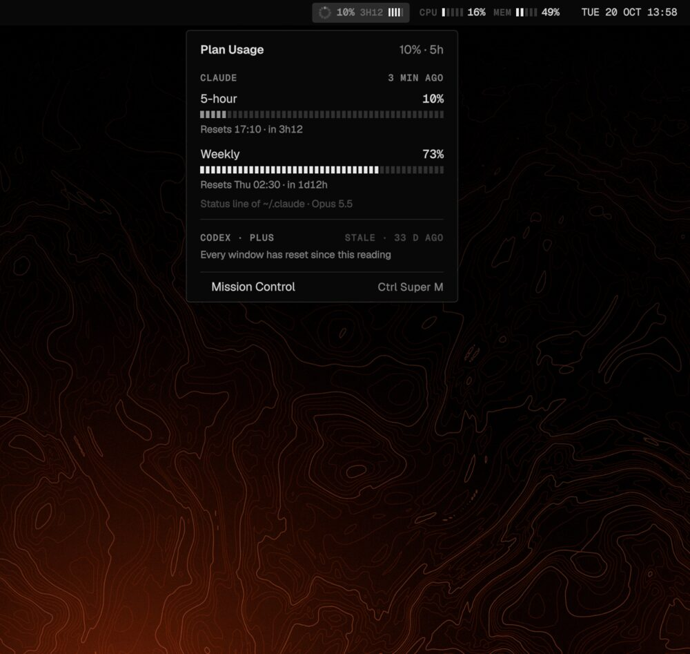
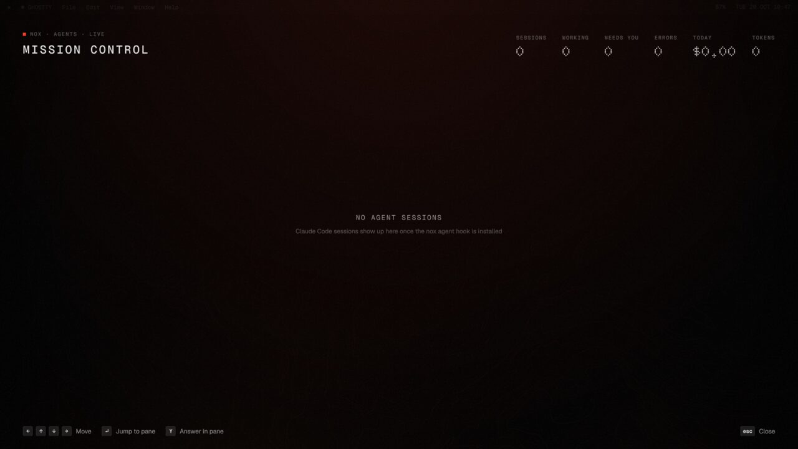

# nox: Parth's desktop

My whole Arch Linux desktop in one repo: **Hyprland 0.56** (Lua config), my own **Quickshell 0.3.2**
shell (`qs -c nox`: bar, dock, launcher, control center, notifications, overview, Mission Control
for coding agents, Circle to Ask, voice typing, a drop shelf, Notes...), one CLI (`nox`), a token-based theme
engine that themes every app from one file, and the apps, binds and settings I use. It is my
personal system, not a distro: my looks, keys and apps are meant to be in here. It is public so I
(or you) can clone it on a fresh install, run one script and get the same desktop.

<p align="center">
  
  
</p>

## Install

On a fresh Arch install (as your user, with sudo available):

```sh
git clone https://github.com/ParthKapoor-dev/dotfiles ~/code/dev/dotfiles/base0
cd ~/code/dev/dotfiles/base0
./install.sh --dry-run     # what is done, what would run; changes nothing
./install.sh               # do it; then log out and back in (or reboot)
nox doctor                 # red/green report, a fix command for every red line
```

`install.sh` is idempotent: every step checks first, prints `[ok]` when there is nothing to do,
and can be re-run any time. `--only stow,theme` / `--skip packages` pick steps, `--yes` answers
every prompt, `--list` lists them. (`setup.sh` is an alias kept for old habits.)

| Step | What it does |
|---|---|
| `preflight` | Arch, not root, sudo present |
| `packages` | installs what is missing from `packages/pacman.txt` (pacman) and `packages/aur.txt` (paru or yay, if present) |
| `stow` | links every package dir into `~` with GNU stow (`bin`, `systemd-desktop` without folding); a real file in the way is moved to `<file>.pre-nox-<time>` first |
| `migrate` | runs new `migrations/*.sh` once (on a fresh install they are only recorded as done) |
| `detect` | `nox detect`: this machine's monitors, battery, mic, thermal sensor, backlight, GPU into git-ignored local files |
| `theme` | `nox theme apply`: renders the tokens into every app's config |
| `units` | enables the user units (`nox-greeter-sync.path`) |
| extras, asked one by one | `greeter` (login screen, sudo), `battery` (charge cap other than 80%, sudo), `etc` (`/etc` snapshots in `_etc`, every diff shown, sudo), `voice` (whisper.cpp + model), `phone` (kdeconnect-rs build), `hook` (Claude Code hook for Mission Control), `notes` |

Things no script can do for you: `nox greeter install` / `on`, `_battery/root.sh` and the `_etc`
files need sudo (the installer asks); fonts that are not packaged (Apple Color Emoji, Doto) and
apps installed outside pacman (Zed, Hubstaff, Claude Code) are listed as `manual:` lines in
`packages/optional.txt`.

## Repo layout

Every top-level dir without a `_` is a **stow package** (its tree mirrors `~`); `_` dirs are
sources and references, never stowed.

```
hypr/          Hyprland Lua config: nox.lua + nox/*.lua (modules, binds, shells/nox.lua, look from tokens)
quickshell/    the shell: ~/.config/quickshell/nox (core/, services/, modules/, components/)
nox/           the nox CLI (~/.local/bin/nox + ~/.local/lib/nox/*), theme engine, ~/.config/nox:
               tokens.json, presets/, templates/, targets.json, shell.json
ghostty/ kitty/ fuzzel/ btop/ gtk/ zed/ nvim/ tmux/ zsh/ starship/   app configs
dolphin/ fontconfig/ environment/ xdg-desktop-portal/ systemd-desktop/ bin/
packages/      pacman.txt, aur.txt, optional.txt (what the desktop needs, with comments)
migrations/    NNN-*.sh, run once each by nox update / install.sh
docs/          screenshots
_greeter/      the login screen (greetd greeter: its own small Hyprland + Quickshell), `nox greeter`
_notes/        Notes app source (Milkdown); the built web/ is committed in nox/.local/lib/nox/notes-app
_battery/      root half of `nox battery limit`
_etc/          /etc snapshots this desktop depends on (README inside)
_patches/      local patches against upstream (kdeconnect-rs Remote Input)
install.sh  VERSION
```

## The `nox` command

One entry point for everything; `nox help <command>` shows each module's own help.

| Command | |
|---|---|
| `nox theme [render\|check\|diff\|status\|apply\|switch <look>\|revert]` | design tokens -> app themes |
| `nox shell start\|stop\|restart\|status\|log` | the Quickshell shell (`qs -c nox`) |
| `nox ipc <target> <fn>`, `nox toggle <panel>`, `nox widgets ...` | talk to the running shell |
| `nox hypr status\|check\|on` | the Hyprland Lua config (`check` = `--verify-config`) |
| `nox layout`, `nox workspaces` (`ws`), `nox dpms` | tiling layouts, saved sessions, screen power |
| `nox shot`, `nox record`, `nox ask` | screenshots + OCR + pins, screen recording, Circle to Ask |
| `nox shelf add\|list\|open\|undo\|clear` | the drop shelf: park files, text, images, links at the screen edge (Super+Shift+D) |
| `nox wallpaper`, `nox activity`, `nox notes`, `nox files` | wallpaper + slideshow + prep, commit grid, Notes, Dolphin menu |
| `nox voice`, `nox phone`, `nox agents`, `nox battery` | dictation, KDE Connect phone link, coding agents, charge limit |
| `nox greeter` | the login screen (sync, test, install, on/off) |
| `nox detect`, `nox doctor`, `nox update`, `nox status` | machine values, health check, update, quick status |

## Theme system

`~/.config/nox/tokens.json` is the single source of every colour, radius, font, size and timing
(base look **Ember**: black + one orange accent). Looks in `presets/*.json` are overlays
(`telemetry`, `sequoia`, `minimal`); `local.json` (git-ignored) holds the chosen look and any
local overrides. `nox theme` deep-merges tokens <- preset <- local.json, renders every template
listed in `targets.json` into `~/.local/state/nox/out/`, and `apply` hooks those outputs into
GTK 3/4, KDE/Dolphin, ghostty, kitty, fuzzel, btop, hyprlock, satty (with a backup;
`nox theme revert` undoes it). The shell and Hyprland read the merged `tokens.json` / `tokens.lua`
live. Adding an app = one template + one `targets.json` entry.

```sh
nox theme                  # list looks (* = current)
nox theme switch telemetry # switch look; apps reload
nox theme diff             # what apply would change
```

`hypr/nox/base.lua` is generated from `tokens.json` alone (target `hypr-base`) and committed: it
is Hyprland's fallback when the state dir has no tokens yet.

## Local overrides (git-ignored)

The tracked files hold my settings with generic fallbacks; anything about *this machine* lives in
git-ignored files next to them:

| File | Written by | Holds |
|---|---|---|
| `~/.config/nox/machine.json` | `nox detect` | facts: monitors, battery, mic, thermal sensor, backlight, GPU |
| `~/.config/nox/shell.local.json` | `nox detect` + you | deep-merged over `shell.json` (e.g. `voice.source`, `battery.device`, `phone.device`); see `shell.local.example.json` |
| `~/.config/hypr/nox/machine.lua` | `nox detect` | Hyprland `settings.monitors` |
| `~/.config/hypr/nox/local.lua` | you | any Hyprland setting/token, plus an `after(ctx)` hook; wins over machine.lua (`local.example.lua`) |
| `~/.config/nox/local.json` | `nox theme switch` + you | current look + token overrides (`local.example.json`) |

`nox detect` keeps a value you changed by hand, and keeps saved monitors that are unplugged; it
asks before replacing a saved monitor mode with a different live one. Shell modules are switched
in `shell.json` `"modules": { "<name>": true|false }` (defaults for all in `core/Config.qml`).

## Update and health

```sh
nox update          # git pull --ff-only, new migrations, re-stow, theme apply, doctor summary
nox update --check  # incoming commits + pending migrations, changes nothing
nox doctor          # packages, links (and broken ones), machine values, theme, Hyprland,
                    # shell, units, migrations, extras: each red item with its fix
```

`VERSION` is bumped with changes that need a migration; migrations are small, idempotent scripts
in `migrations/` and run once per machine (state in `~/.local/state/nox/migrations`).

## Optional extras

- **Login screen**: `nox greeter install && nox greeter on` (sudo). The greeter is a separate
  Hyprland + Quickshell running as greetd's `greeter` user, themed from the current look, with the
  monitors from `nox detect`. `nox greeter test` previews it in the session.
- **Voice typing** (hold Super+Shift+Space): `nox voice setup` builds whisper.cpp with Vulkan and
  downloads the model; everything stays local.
- **Phone link**: `nox phone build` clones [cosmic-utils/kdeconnect](https://github.com/cosmic-utils/kdeconnect)
  at a pinned commit, applies `_patches/kdeconnect-rs-remote-input.patch` (remote mouse and
  keyboard), builds and installs `kdeconnect-service`; `nox phone pair`.
- **Mission Control for coding agents** (Ctrl+Super+M): `nox agents hook install` adds the
  read-only status hook to `~/.claude/settings.json`.
- **Battery cap**: 80% works without root (`nox battery`); another cap: `nox battery limit <N>`.
- **`/etc` bits**: `./install.sh --only etc` shows each diff against `_etc/` before installing it.
- **Wallpaper upscaling**: realesrgan-ncnn-vulkan in `~/.local/share/nox/realesrgan` (`nox wallpaper prep`).
